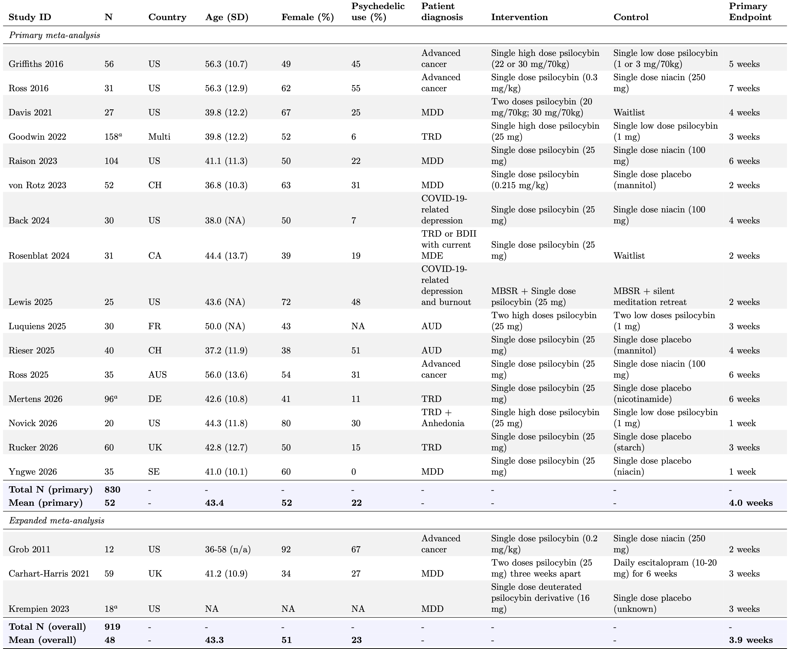
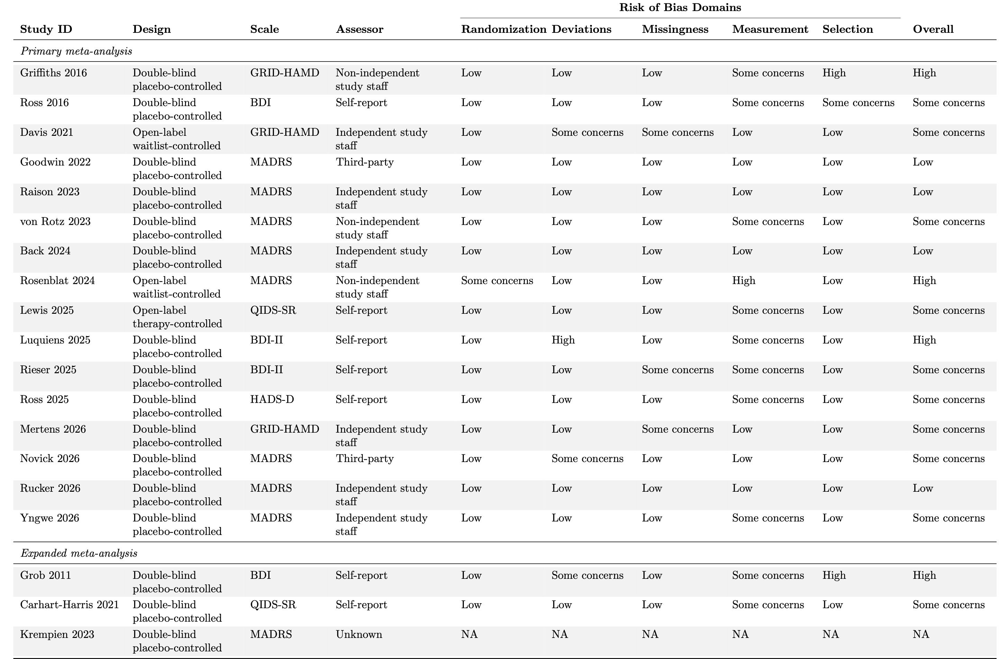
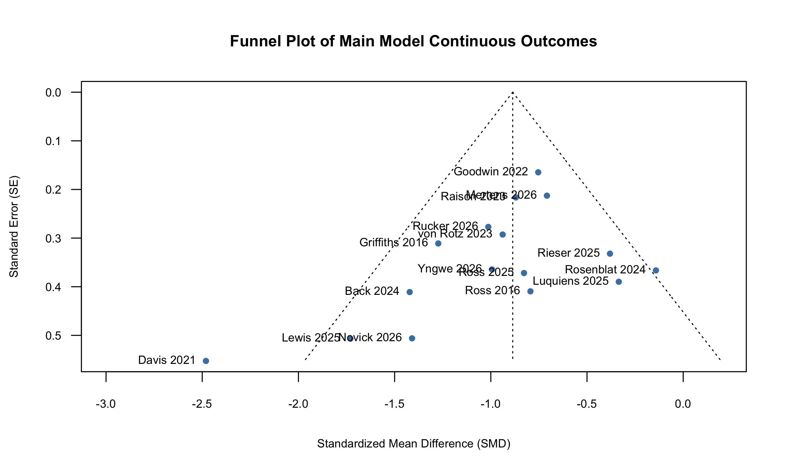
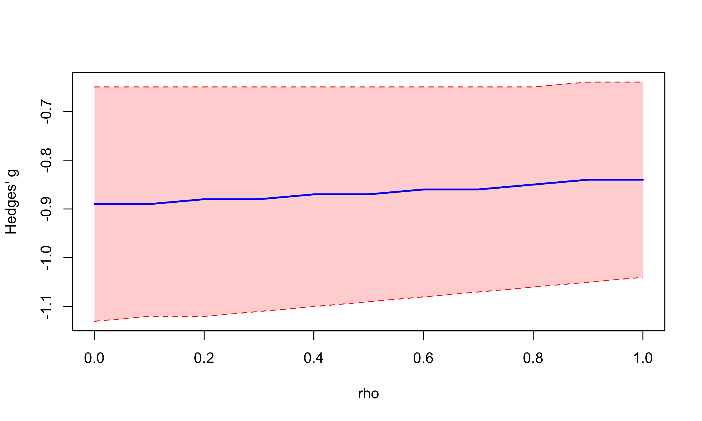
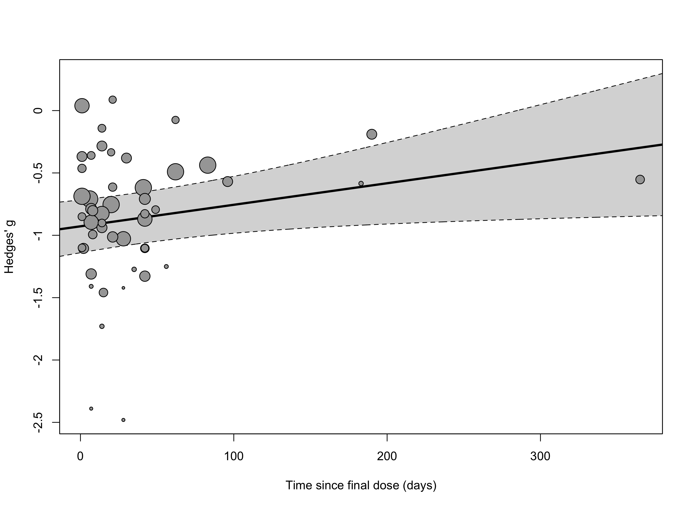
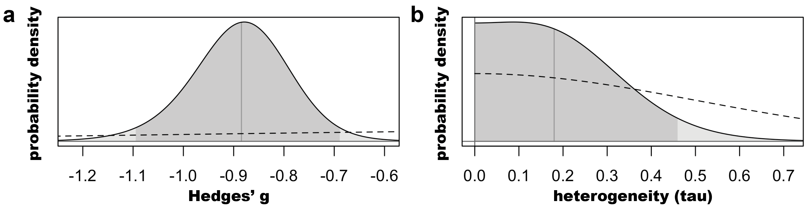

## About this page
Welcome to the landing page for our living systematic review and meta-analysis on psilocybin for depression symptoms (pre-registered [here](https://www.crd.york.ac.uk/PROSPERO/view/CRD42024584938))!
Follow the links in our documentation section for relevant information including our code-walkthrough ([reproducibility guide](/docs/datasets/psilodep-meta-analysis)).
Here we provide an overview of our latest results.
These are updated with each new release of our database and may differ from our [published paper](https://www.nature.com/articles/s44220-026-00630-8); see [Version history](#version-history) for what has changed between releases.

**What's new in database version 26.1.0 (November 2026)** <!-- TODO: release date -->

- **New studies:** Our search now runs to November 6, 2026. Four new trials (Mertens 2026, Novick 2026, Rucker 2026 and Yngwe 2026) bring the primary model from 12 to 16 studies (*n* = 585 to 792) and the database from 15 to 19 studies. One additional study [(Khan 2026)](https://geneticsmr.com/index.php/gmr/article/view/598) was identified but not included in our database or analyses due to a lack of clear reporting, implausible effect sizes, and no response from the authors after multiple attempts of contact.
- **Similar effect, more precise estimates:** The pooled effect is essentially unchanged (Hedges' *g* = \-0.89 \[-1.11; \-0.66\], previously \-0.90 \[-1.26; \-0.55\]), but its confidence interval is about a third narrower and estimated between-study heterogeneity is lower (*tau2* = 0.02, previously 0.12; *I2* = 41%, previously 54%). Most subgroup and sensitivity analyses show the same pattern, and the MDD subgroup is now statistically significant.
- **Effects now weaken modestly over time:** Previously, we found no significant change in effect with time since dosing. With new long-term follow-up data, effects now weaken by about 0.17 Hedges' *g* per 100 days. This finding rests on few timepoints beyond 100 days and is no longer significant without the 12-month timepoint from Yngwe 2026. **This differs from our published paper.**
- **Method changes:** Mertens 2026 contributes its first-phase comparison of 25 mg psilocybin vs. nicotinamide, and its 5 mg arm joins Goodwin 2022's 10 mg arm in the alternate dosing sensitivity analysis. The MADRS-SR was added to the self-report instrument hierarchy (used for Yngwe 2026).
- **Data corrections:** Rieser 2025's outcome is now correctly recorded as the BDI-II (was previously BDI).

## Plain-language summary
This page summarizes what randomized clinical trials currently suggest about psilocybin for depression in simple terms.

- **What we asked:** Do people with depression improve more after a psilocybin treatment than after a comparison condition (like a placebo or very low dose), when both are paired with psychological support?
- **Who was studied:** Adults with depression, including major depressive disorder and treatment‑resistant depression; some trials included people with other conditions (e.g., cancer, alcohol use disorder).
- **What was the intervention?:** Trials gave psilocybin at doses intended to produce a noticeable psychedelic experience, typically alongside structured psychological support. Microdosing studies were not included.
- **What we found:** Across 16 randomized studies including nearly 800 people, psilocybin was associated with larger improvements in depression scores than comparison conditions. In studies that reported it, people receiving psilocybin were also more likely to meet common definitions of getting better (response) or having very low depression symptoms (remission) after therapy.
- **How confident are we?:** Results were consistent across several additional analyses that served as checks on the primary results, but studies differed in design and quality. Some trials used designs that can introduce uncertainty. Overall, the direction of effects were similar, though the size of the benefit varied across studies.
- **What this does not mean:** This is not medical advice. Psilocybin is not approved to treat depression in most places, and it may not be right or safe for everyone. Most trials provided structured psychological support alongside psilocybin and included strict criteria that people had to meet to be enrolled in the trial; these results may not generalize without such support or in a broader population. Studies only followed participants for a few months or less, so long‑term benefits and risks are less clear.
- **Safety note:** This page focuses on whether depression symptoms improved. Adverse effects and safety were not the primary focus here and will be considered in the future.
- **We will keep this updated:** This is a living review. As new randomized controlled trials are published, we update our analyses and figures. For methods and full details, see the [reproducibility guide](/docs/datasets/psilodep-meta-analysis) and [search strategy](/docs/datasets/psilodep_search/). An interactive overview is available on our [dashboard](http://metapsy.org/sypres/psilocybin-depression).

## Eligibility Criteria
We included randomized controlled clinical trials published in English in peer-reviewed journals comparing psilocybin for depressive symptoms with a comparator in adult (\>18 years old) populations.
Eligible interventions included any dose and formulation (natural or synthetic) of psilocybin or other prodrugs of psilocin intended to produce an alteration of subjective experience in the patient, with or without the conjunctive use of therapy.
Eligible comparators included any form of placebo with or without the conjunctive use of therapy, including low doses of the intervention drug and any dose of other psychotropics intended to improve blinding (without known therapeutic efficacy for depression).
Eligible comparators also included control for spontaneous improvement via waitlist or usual care.
To make our database more comprehensive, we also conducted sensitivity analyses where we expanded these criteria to include reports found in gray literature (Krempien 2023), studies presenting only a mixture of pre- and post-crossover data (Grob 2011), and studies comparing psilocybin with comparators with known therapeutic efficacy (Carhart-Harris 2021).
However, these studies were not included in the primary analyses.

## Study selection
We screened 1,330 reports from our [searches](/docs/datasets/psilodep_search/) following duplicate removal and the removal of 2,198 reports marked as ineligible by Covidence automation tools.
Of these, 150 passed initial title and abstract screening, while 19 reports (1060 participants) were included after full-text review, with 16 reports (953 participants) meeting inclusion criteria for our primary model.
One additional report ([Khan 2026](https://geneticsmr.com/index.php/gmr/article/view/598)) was identified but not included in our database or analyses due to a lack of clear reporting, implausible effect sizes, and no response from the authors after multiple attempts of contact.

***Figure 1:*** *PRISMA flow diagram showing study selection process*

## Study Characteristics

Our database consists of 558 effect sizes generated from 19 studies, covering multiple depression instruments, outcome types (e.g. endpoint, change-score, or dichotomous), and time-points (from baseline to 12 months).
As shown in Table 1, primary endpoints ranged from 1 to 7 weeks, with an average endpoint of 4 weeks.
The primary outcome instrument was chosen hierarchically, with the primary outcome identified by the study receiving preference if it measured depression, followed by a preference for clinician-rated depression measures.

***Table 1:*** *Summary of RCTs on psilocybin for depressive symptoms.
N given is the number of participants randomized. Study endpoints are the reported primary endpoints for each study and given in weeks since the final dose. In the summary rows (blue), Total N is a sum and mean N a simple mean; age, percent female, psychedelic use and endpoint are means weighted by N, excluding studies that did not report the value. Mean age uses the midpoint of the age range reported by Grob 2011\. a N for these studies reflects only the arms used in our analyses. Additional arms in Goodwin 2022 (75), Mertens 2026 (48), and Krempien 2023 (18) bring the total N for the database to 1060\. These arms are included in the database but not used in the present analyses, except the additional Goodwin 2022 and Mertens 2026 arms, which are used in the alternate dosing sensitivity analysis. AUS \= Australia; CA \= Canada; CH \= Switzerland; DE \= Germany; FR \= France; Multi \= multi-site; SE \= Sweden; UK \= United Kingdom; US \= United States. MDD \= major depressive disorder; TRD \= treatment-resistant depression; AUD \= alcohol use disorder; BDII with current MDE \= Bipolar Disorder II with current Major Depressive Episode; MBSR \= mindfulness-based stress reduction.
*

## Risk of Bias

We assessed study bias using Cochrane’s Risk of Bias 2.0 tool, which is the standard approach for bias assessment in randomized controlled trials.
We focused our assessment specifically on primary outcome variables.
In studies with multiple primary outcomes or where the primary outcome was not a depression measure, we evaluated the outcome selected for our primary meta-analysis. Furthermore, we limited our bias assessment to pre-crossover data only.
If information pertinent to assessment of risk of bias was not available, authors were contacted via email.

The RoB 2.0 tool examines five potential bias sources: randomization procedures, deviations from the intended protocol, missing outcome data, outcome measurement, and selective reporting.
Each domain contains several questions rated on a four-level scale ranging from ‘yes’ to ‘no’, in addition to an option for insufficient information.
Domain-level and overall study bias ratings are classified as low, medium, or high according to a predetermined algorithm.
While this algorithm guides assessment, evaluators may justifiably override automated bias determinations when specific concerns warrant greater or lesser emphasis than the algorithm suggests.

***Table 2:*** *Additional study characteristics and risk of bias assessments using Cochrane’s Risk of Bias 2.0 tool domains.
Randomization = bias due to randomization process;
Deviations = bias due to deviations from intended interventions;
Missingness = bias due to missing outcome data;
Measurement = bias due to measurement of the outcome;
Selection = bias due to selection of the reported results;
Overall = overall risk of bias;
BDI = Beck Depression Inventory; GRID-HAMD = Grid Hamilton Rating Scale for Depression; MADRS = Montgomery-Asberg Depression Rating Scale; QIDS-SR = Quick Inventory of Depressive Symptomatology–Self-Report; HADS-D = Hospital Anxiety and Depression Scale–Depression.*

Overall, 4 studies were determined to have a high risk of bias, 10 studies had some concerns, and 4 studies were deemed to have an overall low risk of bias (**Table 2**). Rosenblat 2024 received some concerns for randomization due to the significant imbalance in baseline depression severity between the two arms. This imbalance favors the comparator in our effect size calculation for this study. Krempien 2023 did not receive a risk of bias rating as the results have not been peer-reviewed.

## Results

### Psilocybin treatment significantly reduces depression symptoms compared with control conditions

The analysis on continuous outcomes in the 16 studies included in the primary model showed a statistically significant reduction in depression scores after psilocybin treatment compared with control conditions (**Figure 2**; Hedges’ *g* \= \-0.89 \[-1.11; \-0.66\], *p* \< 0.001, *k* \= 16, *n* \= 792), with moderate between-study heterogeneity (*tau2* \= 0.02 \[0.00; 0.57\], *I2* \= 41.3% \[0.0%; 67.5%\]).

*Figure 2: Meta-analysis on continuous outcome variables.
Boxes represent the standardized mean difference (Hedges’ g) for each study, and the lines extending from the box represent the 95% confidence interval around each effect size, while the size of each box is proportional to its weight.
The diamond at the bottom represents the pooled effect size (meta-analytic mean).
The gray line at the bottom represents the prediction interval of the expected range of true effects in a new study. HK = Knapp-Hartung adjustment.*

Visual inspection of a funnel plot (**SI Figure 1**) revealed limited asymmetry, and an Egger’s test did not find small study effects (*intercept* \= \-1.59 \[-3.38; 0.19\], *t* \= \-1.75, *p* \= 0.10).

***SI Figure 1:*** *Funnel plot of 16 studies in primary meta-analytic model.*

### Psilocybin’s effects are rapid and moderately attenuate over time

Our three-level CHE model revealed an overall significant decrease in depression scores with psilocybin compared to the control conditions (Hedges’ *g* \= \-0.86 \[-1.08; \-0.65\], *p* \< 0.001, *k* \= 16, *n* \= 830, *tau2* \= 0.10 \[0.03; 0.24\], *I2* \= 57.3% \[24.7%; 75.9%\]), ensuring that our results were not sensitive to the time point studied. These results were consistent across a range of within study correlation coefficients (**SI Figure 2**).

***SI Figure 2:*** *Hedges’ *g* as a function of *rho* (*ρ*), the within-study correlation coefficient used in the three-level CHE model. The blue line represents the estimated pooled effect, and the shaded red region represents the confidence interval.*

Adding time since final dose as a continuous predictor to our model (**SI Figure 3**) revealed a significant effect favoring psilocybin immediately following dosing (*intercept* \= \-0.93 \[-1.14; \-0.72\], *p* \< 0.0001). Psilocybin's effects weakened by about 0.17 Hedges' *g* per 100 days following the last dose (*slope* \= 0.0017 \[0.0002; 0.0033\], *p* \= 0.03), however available data beyond 100 days was sparse (2 timepoints at ~6 months and 1 timepoint at 12 months). Without the Yngwe 2026 12 month timepoint, this effect is no longer significant.

***SI Figure 3:*** *Meta-regression of time since final dose on the three-level CHE model.*

### Higher response and remission rates after psilocybin treatment
In addition to differences in symptoms of depression, we found evidence for statistically significant greater treatment response with psilocybin compared to control conditions (**SI Figure 4**; *RR* \= 2.71 \[1.98; 3.70\], *p* \< 0.001, *k* \= 9, *n* \= 587), with low between-study heterogeneity (*tau2* \= 0.00 \[0.00; 1.10\]; *I2* \= 0.0% \[0.0%; 64.8%\]).

***SI Figure 4:*** *Meta-analysis on response to treatment.
Boxes represent the risk ratio (*RR*) for each study, and the lines extending from the box represent the 95% confidence interval around each effect size, while the size of each box is proportional to its weight.
The diamond at the bottom represents the pooled effect size (meta-analytic mean).
The gray line at the bottom represents the prediction interval of the expected range of true effects in a new study.*

We also found that there were significantly higher remission rates with psilocybin compared to control conditions (**SI Figure 5**; *RR* \= 4.42 \[3.65; 5.36\], *p* \< 0.001, *k* \= 10, *n* \= 612), with low between-study heterogeneity (*tau2* \= 0.00 \[0.00; 0.00\]; *I2* \= 0.0% \[0.0%; 62.4%\]).

***SI Figure 5:*** *Meta-analysis on remission rates.
Boxes represent the risk ratio (*RR*) for each study, and the lines extending from the box represent the 95% confidence interval around each effect size, while the size of each box is proportional to its weight.
The diamond at the bottom represents the pooled effect size (meta-analytic mean).
The gray line at the bottom represents the prediction interval of the expected range of true effects in a new study.*

## Subgroup and sensitivity analyses

To assess the robustness of our primary findings and explore potential sources of heterogeneity, we conducted a series of 5 subgroup analyses for continuous outcomes (**Figure 3**).
These analyses allowed us to evaluate the consistency of treatment effects across different study characteristics and methodological approaches.
Each subgroup analysis described below employed the same meta-analytic model parameters as our primary analysis.

1. **Diagnosis of major depressive disorder (MDD):** To assess whether participant diagnosis impacted treatment effects, we conducted a subgroup analysis limited to studies focused on patients with a formal diagnosis of MDD (includes Davis 2021, Goodwin 2022, Raison 2023, von Rotz 2023, Rosenblat 2024, Mertens 2026, Novick 2026, Rucker 2026, and Yngwe 2026).
2. **Exclude open-label:** We evaluated the impact of excluding open-label studies (excluding Davis, 2021, Rosenblat, 2024, and Lewis 2025).
3. **Exclude high RoB:** To assess the impact of study quality on outcomes, we excluded studies rated as having high risk of bias (excluding Griffiths 2016, Rosenblat 2024, and Luquiens 2025).
4. **Parallel design:** We conducted a subgroup-specific analysis that only included parallel group studies (including Goodwin 2022, Raison 2023, von Rotz 2023, Back 2024, Lewis 2025, Luquiens 2025, Rieser 2025, Novick 2026, Rucker 2026, Yngwe 2026).
5. **Crossover or open-label extension design:** We conducted an analysis that only included crossover design studies and studies with open-label extension periods (including Griffiths 2016, Ross 2016, Davis 2021, Rosenblat 2024, Ross 2025, and Mertens 2026).

The following sensitivity analyses were also performed, again employing the same meta-analytic model parameters as our primary analysis (except for the fixed effects models):

1. **Expanded inclusion criteria:** We first conducted an analysis with expanded eligibility criteria that incorporated all studies from the main model plus three additional studies that were excluded from the primary analysis: one study from grey literature (Krempien 2023; high-dose versus control), one with an active comparator (Carhart-Harris 2021), and one where pre- and post-crossover data were combined together (Grob 2011).
2. **Excluding outliers:** We repeated our primary meta-analysis on continuous outcomes after removing the statistical outlier studies (e.g. those whose effect size confidence intervals do not overlap with the confidence interval of the pooled effect; Davis 2021).
3. **Fixed effects model:** We ran fixed-effects models as a sensitivity analysis to compare to the random effects models. The fixed effects model assumes that the between-study variance (tau2) is 0, such that all studies share a common true effect size. For our continuous model, we used a standard inverse-variance weighting fixed-effects model on standardized mean differences (Hedges’ g). For our dichotomous model, we used a standard inverse-variance weighting fixed-effects model on the log risk ratio.
4. **Alternate dosing:** Given that Goodwin 2022 employed a three-arm design comparing psilocybin at 25 mg and 10 mg doses against a 1 mg control, we conducted a subgroup analysis substituting the 10 mg intervention arm for the 25 mg arm used in our main analysis. Likewise, Mertens 2026 employed a three-arm design comparing 25 mg psilocybin against a 5 mg control and a nicotinamide control. The main analysis compares 25 mg psilocybin to nicotinamide, while here we compare 25 mg psilocybin vs 5 mg psilocybin.
5. **Clinician-rated outcomes:** To examine whether the method of assessment influenced observed effects, we conducted a sensitivity analysis that only included clinician-administered depression assessments. MADRS was chosen as the preferred clinician-administered instrument for this analysis, followed by the GRID-HAM-D. Studies included were: Goodwin 2022, Raison 2023, von Rotz 2023, Back 2024, Rosenblat 2024, Novick 2026, Rucker 2026, and Yngwe 2026 using the MADRS, and Griffiths 2016, Davis 2021, and Mertens 2026 using the GRID-HAM-D.
6. **Self-report outcomes:** Similarly, we conducted a sensitivity analysis that only included studies reporting self-report depression measures, regardless of whether these were the primary outcome measures. BDI was the preferred self-report instrument, followed by the QIDS-SR, then the MADRS-SR. Studies included were: Ross 2016, Griffiths 2016, Davis 2021, von Rotz 2023, Luquiens 2025, Rieser 2025, Ross 2025 and Mertens 2026 for BDI; Goodwin 2022, Lewis 2025, Novick 2026, and Rucker 2026 for QIDS-SR; and Yngwe 2026 for MADRS-SR.
7. **Bayesian meta-analysis:** We replicated our primary meta-analysis on continuous outcomes using a Bayesian implementation. We used “weakly informative” prior distributions for both the main effect and the heterogeneity parameter *tau* that have been recommended by prior work. The main effect prior was a normal distribution centered around 0, with a standard deviation of 1, while the *tau* prior was a half-normal distribution with a standard deviation of 0.5.

### Subgroup analyses reveal open-label, cross-over designs, risk of bias, and patient diagnosis as sources of heterogeneity

Our subgroup-specific analyses produced results largely in line with our primary model results. Hedges’ *g* values of each subgroup-specific analysis were largely similar to the primary model, with all five analyses showing significant results (**Figure 3**). Notably, subgroup-specific analyses excluding either open-label studies, crossover studies, studies with high risk of bias, or studies without a primary diagnosis of MDD/TRD had substantially lower between-study heterogeneity (**Figure 3**).

***Figure 3:*** *Pooled effect sizes for subgroup and sensitivity analyses. Box and whiskers represent the meta-analytic mean and corresponding 95% confidence intervals for each subgroup analysis. K and tau2 represent the number of studies included in each analysis and heterogeneity for each analysis, respectively. The pooled effect size from the main model is presented at the top for comparison purposes.*

### Sensitivity analyses show significant and comparable results to the main model
We performed a series of sensitivity analyses that largely supported our primary results.
First, our model using expanded inclusion criteria showed a significant and comparable effect size (**SI Figure 6**; Hedges’ *g* \= \-0.88 \[-1.10; \-0.65\], *p* \<0.001 , *k* \= 19, *tau2* \= 0.05 \[0.01; 0.59\], *n* \= 893). We also ran a model removing statistical outliers (Davis 2021), resulting in a significant effect size comparable to the primary model (Hedges’ *g* \= \-0.84 \[-1.02; \-0.66\], *p* \<0.001, *k* \= 15, *n* \=768) and reduced heterogeneity (*tau2* \= 3.9x10-6 \[0.00; 0.30\]). Furthermore, we replicated our primary analyses using a fixed effects model on both continuous outcomes (Hedges’ *g* \= \-0.87 \[-1.02; \-0.72\], *p* \< 0.001, *k* \= 16, *n* \= 792), response outcomes (*RR* \= 2.89 \[2.18; 3.83\], *p* \< 0.001, *k* \= 9, *n* \= 587), and remission outcomes (*RR* \= 4.58 \[3.10; 6.77\], *p* \<0.001, *k* \= 10, *n* \= 612). Separate models evaluating self-report (Hedges’ *g* \= \-0.89 \[-1.28; \-0.50\], *p* \< 0.001, *k* \= 13 , *tau2* \= 0.15 \[0.06; 1.55\], *n* \= 632\) and clinician-administered (Hedges’ *g* \= \-0.94 \[-1.22; \-0.66\], *p* \< 0.001, *k* \= 11, *tau2* \= 0.03 \[0.00; 0.83\], *n* \= 645\) outcomes yielded comparable results, with the clinician-administered model having less heterogeneity despite fewer studies.

***SI Figure 6:*** *Forest plot of 19 studies in the expanded model. Boxes represent the standardized mean difference (Hedges’ g) for each study, and the lines extending from the box represent the 95% confidence interval around each effect size, while the size of each box is proportional to its weight. The diamond at the bottom represents the pooled effect size (meta-analytic mean). The gray line at the bottom represents the prediction interval of the expected range of true effects in a new study. HK \= Knapp-Hartung adjustment.*

Finally, our Bayesian analysis revealed a Hedges’ *g* posterior distribution centered at \-0.88 \[-1.09; \-0.69\] (**SIFigure 7**).

***SI Figure 7:*** *Prior (dashed) and posterior (solid) distributions for (**a**) the pooled effect size (Hedges’ g) *and (**b**) the heterogeneity estimate (tau). Dark shading represents the 95% probability distribution.*

## Conclusions

Our initial meta-analytic results show promise for the efficacy of psilocybin in treating depressive symptoms, however these results should be interpreted with caution.
As more RCTs are published, we will regularly update our SYPRES website and dashboard in a reproducible and transparent manner.
This living systematic review, in conjunction with the associated open-science resources, aims to provide a valuable and transparent resource for researchers, clinicians, policymakers, and the public.

## Version history

Each version corresponds to a [release of our database](https://github.com/metapsy-project/data-depression-psiloctr/releases) on Metapsy; version numbers refer to the database, not to this website.
Version numbers follow a year.minor.patch format: minor releases add studies from an updated search, and patch releases correct existing data.
Results on this page are always computed from the version shown in the sidebar.

### [26.1.0](https://github.com/metapsy-project/data-depression-psiloctr/releases/tag/26.1.0) (November 2026)

Updated search (to November 6, 2026) adding Mertens 2026, Novick 2026, Rucker 2026 and Yngwe 2026, along with the method changes and data corrections listed at the top of this page.
Khan 2026 was also identified but not added to the database (see [Study selection](#study-selection)).
The table below compares key results with the previous release.

| Analysis | 26.0.0 | 26.1.0 |
|---|---|---|
| Primary model, Hedges' *g* | \-0.90 \[-1.26; \-0.55\] *k* = 12, *n* = 585, *tau2* = 0.12 | \-0.89 \[-1.11; \-0.66\] *k* = 16, *n* = 792, *tau2* = 0.02 |
| Three-level model, Hedges' *g* | \-0.82 \[-1.08; \-0.55\] *tau2* = 0.14 | \-0.86 \[-1.08; \-0.65\] *tau2* = 0.10 |
| Time since dose, slope per day | 0.0017 \[-0.0010; 0.0045\], *p* = 0.20 | 0.0017 \[0.0002; 0.0033\], *p* = 0.03 |
| Response, *RR* | 2.77 \[1.93; 3.97\], *k* = 5 | 2.71 \[1.98; 3.70\], *k* = 9 |
| Remission, *RR* | 4.19 \[3.52; 4.99\], *k* = 6 | 4.42 \[3.65; 5.36\], *k* = 10 |
| MDD subgroup, Hedges' *g* | \-0.93 \[-1.87; 0.01\] *k* = 5, *tau2* = 0.33 | \-0.85 \[-1.13; \-0.57\] *k* = 9, *tau2* < 0.01 |
| Expanded criteria, Hedges' *g* | \-0.88 \[-1.21; \-0.56\] *k* = 15, *tau2* = 0.13 | \-0.88 \[-1.10; \-0.65\] *k* = 19, *tau2* = 0.05 |
| Self-report, Hedges' *g* | \-1.00 \[-1.68; \-0.31\] *k* = 9, *tau2* = 0.49 | \-0.89 \[-1.28; \-0.50\] *k* = 13, *tau2* = 0.15 |
| Clinician-rated, Hedges' *g* | \-1.02 \[-1.60; \-0.44\] *k* = 7, *tau2* = 0.20 | \-0.94 \[-1.22; \-0.66\] *k* = 11, *tau2* = 0.03 |
| Bayesian, Hedges' *g* | \-0.88 \[-1.17; \-0.60\] | \-0.88 \[-1.09; \-0.69\] |

Confidence intervals for *tau2* remain wide and overlap between releases, so lower heterogeneity estimates should be read as a trend rather than a definitive change.

### [26.0.0](https://github.com/metapsy-project/data-depression-psiloctr/releases/tag/26.0.0) (July 2026)

Corrected outcome data for Lewis 2025 and Rieser 2025, with small changes to the three-level model and remission estimates. No new studies.

### [25.1.2](https://github.com/metapsy-project/data-depression-psiloctr/releases/tag/25.1.2)

Search to October 31, 2025; 15 studies (12 in the primary model). The version current when our [paper](https://www.nature.com/articles/s44220-026-00630-8) was published.

## References

